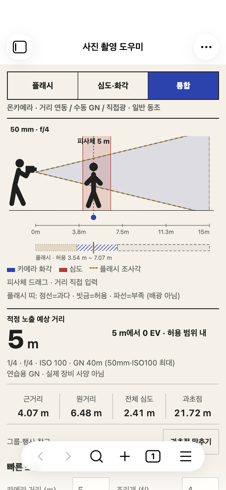
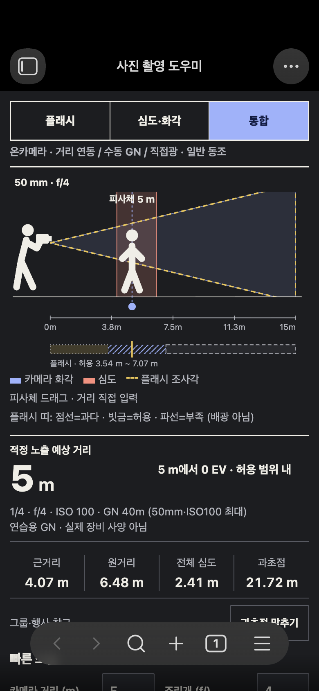

# 바우하우스 적용 · 2026-10-29

사용자가 바우하우스 취향을 명시하고 완성 즉시 적용을 요청하여 선택 대기 단계를 종료했다. 기존 preparation의 미배포 수정과 데이터·원본 라이선스를 유지하며 실제 플러그인을 수정하고 다용도 보관함에 설치했다. 공개 배포는 하지 않았다.

## 바뀐 화면

- 아이보리/검정/파랑의 단단한 구획과2px 모서리, 선명한 숫자/작은 단위, 불필요한 그림자·둥근 카드 제거.
- 빨강 심도·황색 점선 플래시·파랑 화각. 라이트/다크 각각의 색 토큰.
- 통합·심도 탭은 촬영 장면 우선, 플래시는 거리/EV 우선. 거리·조리개를 나란히 배치하고 출력·ISO 우선순위를 정리. 심도 탭의 비관련 출력/ISO 빠른 입력은 숨기되 설정값을 초기화하지 않음.
- 현재 탭 결과 저장을 파랑 기본 버튼, 전체 계산 저장은 별도 보조 버튼. 설정 실패·재시도는 별도 표시.
- 이론 출력은 황색 경고, GN 자료 없음 등 차단 오류는 빨강 텍스트/구획선. 긴 이름·오류 문구 줄바꿈.

계산 엔진·저장 스키마·프리셋 데이터는 변경하지 않았다. `src/diagram.ts`는 안내 문구만 간결하게 바꾸었고 광학 좌표·포인터 모델은 유지했다. 새로운 이미지·폰트·라이브러리·네트워크 의존성 없음. 공개 버전은 올리지 않고1.2.0 로컬 Bauhaus 빌드로 구분한다.

## 실제 확인 결과

| 구분 | 결과 |
| --- | --- |
| strict 빌드 / 자동 검사 | 통과 /50개 |
| 기존 모바일·안정화·장면·스와이프·버그·preparation |17 /14 /10 /6 /8 /10 시나리오 통과 |
| 새 바우하우스 UI 검사 |6개 통과 (`results.json`) |
| 모바일 크기/테마/글자 |360×800·390×844·844×390, 라이트/다크, 기본/20px root: 가로 넘침 없음, 보이는 조작부44px 이상 |
| GN 입력 |40.5 소수 입력→중간에2 삽입→40.25, 포커스/커서/스크롤 유지 |
| 긴 장비명·GN 누락·이론 출력·긴 저장 오류 |내용 유지·줄바꿈·넘침 없음 |
| 색 대비 |ink/muted, 기본 버튼, warning 텍스트의 실제 토큰쌍4.5:1 이상. 전체 WCAG 준수 주장 아님 |
| 실제 설치/실행 |다용도 보관함 파일 교체·백업·설치 복사 시 data.json 동일 확인. Mac Obsidian에서 새 레이블/장면 우선순위가 실제 로드된 것을 native UI로 확인 |
| 실제 휴대전화 |iOS/Android 미검증. 네이티브 소수 키보드/뒤로가기/회전/접근성/안전영역은 남음 |
| 최소 버전 |1.7.4 유지. 보존된1.7.2 API 타입으로 현재src 검사 통과. 1.7.4 실행 미검증 |

설치 확인은 실제 보관함에서 했지만 수치 변경·가상 장비·I/O 실패·노트 생성 회귀는 전용 `/private/tmp/photo-field-qa-vault`에서만 실행했다. 사용자 앱/폰을 강제 종료하거나 잠그지 않았다. 실사용 화면의 기존 입력값을 임의로 기본값으로 바꾸지 않았다.

## 화면과 비교

[수정 전/스타일 참고/수정 후 한 화면 비교](comparison.png). 가운데는 생성 이미지이며 좌우는 실제 앱 캡처다. 서로 다른 호스트 영역·밀도를 명시했다. 상세 시각 QA와 수정 이력: [design-qa.md](../../design-qa.md).

## 설치 산출물과 복구

- `dist/photo-field-mobile-1.2.0-bauhaus.zip`: 설치 파일3개와 MIT 라이선스·원본 고지 포함.
- `dist/photo-field-mobile-1.2.0-pre-bauhaus.zip`: 이번 디자인 직전 preparation 빌드 복구용. GN 커서/탭 저장 개선을 포함한다.
- 파일 해시: [SHA256SUMS.txt](SHA256SUMS.txt).

다용도 보관함의 플러그인 `backups/before-bauhaus-*`에 교체 전 main.js/styles.css/manifest.json/data.json을 보관했다. 복구하려면 해당 플러그인을 끄고 백업의 설치 파일3개를 원래 위치로 돌린 뒤 켠다. **같은 스키마이므로 현재 data.json은 유지**한다. 예전 시점의 설정까지 되돌릴 목적일 때만 현재 data.json을 따로 복사하고 백업 데이터로 복구한다. 생성된 Markdown은 건드리지 않는다. 정확한 로컬 설치·백업 경로 증거는 공개하지 않는 `installation-local.json`에 보관했다.

실제 휴대전화에서 파일 전달·동기화·다시 로드 여부는 확인하지 않았다. Mac의 정상 로드 확인을 iPhone/Android 적용 확인으로 바꾸어 보고하지 않는다.

설치 직전 실사용 데이터는 스키마1이었다. 정상 실행 뒤 기존 마이그레이션으로 스키마2가 기록됐으며, migrationBackup이 설치 전 원본 전체와 일치하고 장비·초안이 유지되는 것을 확인했다. 그 사이 거리·ISO·탭 등 실행 중 입력도 갱신되어 최종 data.json의 바이트 동일성은 주장하지 않는다. 설치 스크립트가 설정을 덮어쓰지는 않았으며 현재 입력을 임의로 백업 값으로 되돌리지 않았다.
