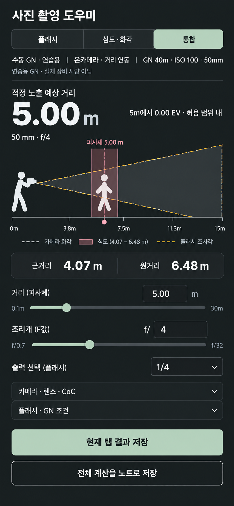
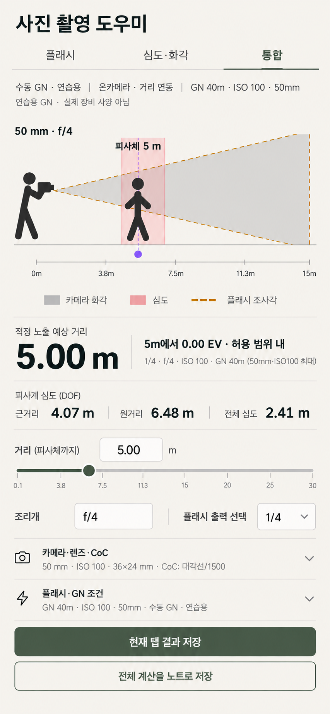
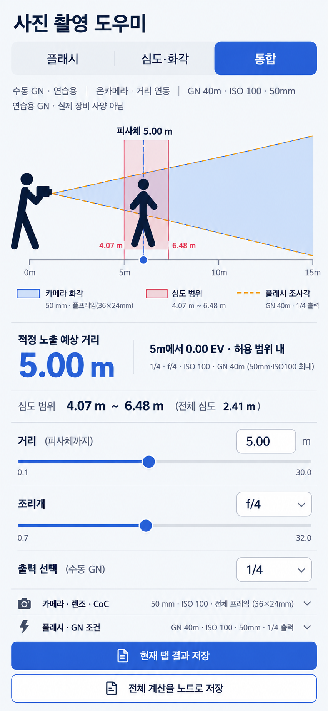

# 사진 촬영 도우미 · 모바일 디자인 시안 비교

2026-10-29. 아래는 **이미지 생성 도구로 만든 최종 디자인 시안이며 실제 작동 화면이 아니다.** 앞서 표시된 초안보다 이 문서의 최종3장을 선택 기준으로 사용한다. 실제 앱 캡처10상태와 발견 사항은 [현재 화면 검토](REVIEW.md).

세 PNG 모두 동일853×1844px. 논리390×844 모바일 프레임을 기준으로 약2.19배 크기로 생성했다(비율 반올림 포함). 프레임·그림을 강제로 늘이거나 자르지 않았다. 정확한390×844 픽셀 배치·44px 터치/키보드·안전영역 검사는 실제 구현 단계에서 한다. 생성 이미지의 눈금·슬라이더 손잡이 위치는 정밀 계산 검증이 아니며, 구현 시 기존 계산 엔진/장면 좌표/슬라이더 범위를 기준으로 맞춘다.

공통 입력: 통합 탭 · 풀프레임36×24mm · 실제50mm · f/4 · ISO100 · 온카메라5m · GN40m(연습용, 기준/선택 줌50mm) · 출력1/4 · 손실0. 예상5m/0EV, 심도4.07–6.48m. 모두 촬영자·피사체·화각·심도 한 장면, 직접 입력·슬라이더, 출력 선택, 접힌 설정, 탭/전체 저장 구분을 유지하는 제안이다.

## A · 정밀한 카메라 도구

차콜 바탕·세이지 강조. **거리와EV → 장면 → 조작** 순서. 반복해서 수치를 확인하는 촬영 도구 느낌을 가장 강조했다.

## B · 밝은 미니멀 도구

따뜻한 중성색·올리브. **장면 → 결과 행 → 가벼운 설정 목록**. 테두리와 카드 대신 선·정렬로 구분하는 차분한 방향이다.

## C · 시각적 촬영 시뮬레이터 · 추천

큰 장면과 명료한 파랑 화각·분홍 심도·황색 점선 플래시. **장면 → 연결된 결과 → 거리·조리개·출력 조작**. 원본의 ‘값을 바꾸며 장면을 이해하는 경험’에 가장 잘 맞는다.

선택 전 실제 플러그인 적용 없음. 선택 후에도 외부폰트·CDN·새 계산 모델·저장 스키마를 추가하지 않고 기존 preparation 수정과 원본 라이선스/고지를 유지한다. 라이트·다크·오류·긴 이름·오프카메라까지 같은 시각 체계로 구현하고 관련 회귀 검사를 실행할 예정이다.

생성 도구: 내장 Image Gen. 최종 이미지3장과 최초/수정 프롬프트는 이 폴더에 보관했다(`prompts.json`). 외부 앱 화면의 상표·자산을 제품에 가져오지 않았다.
