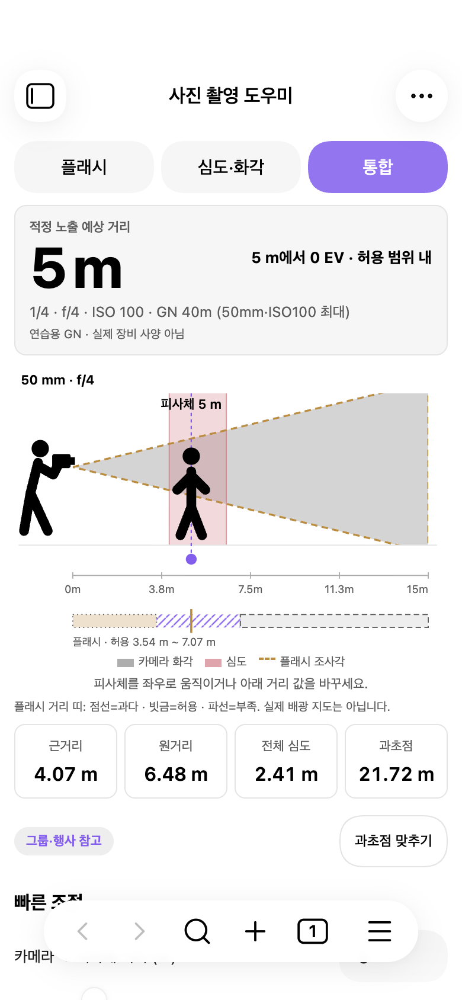
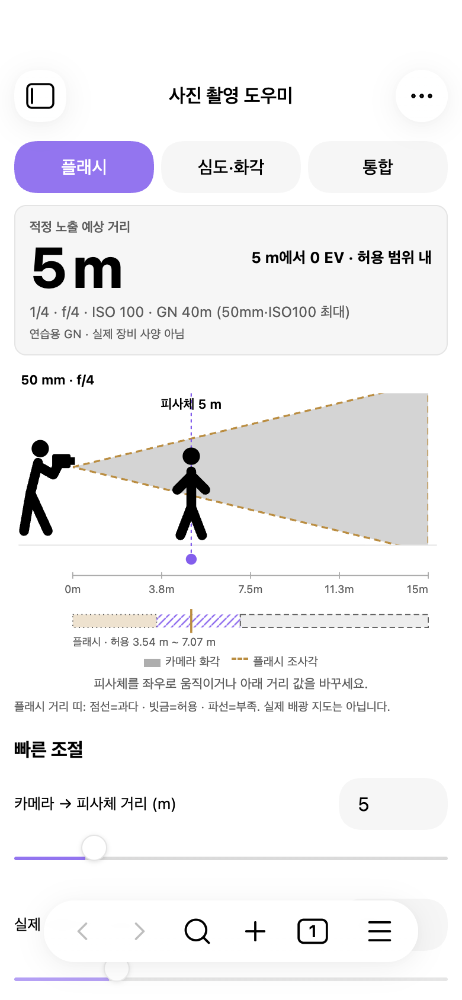
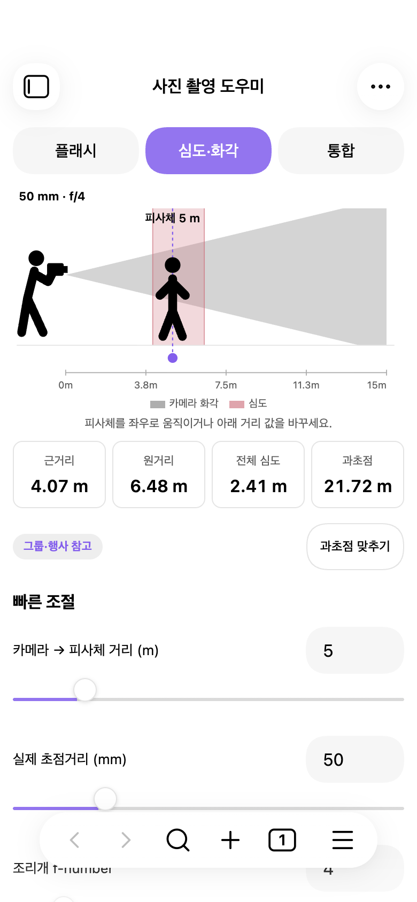
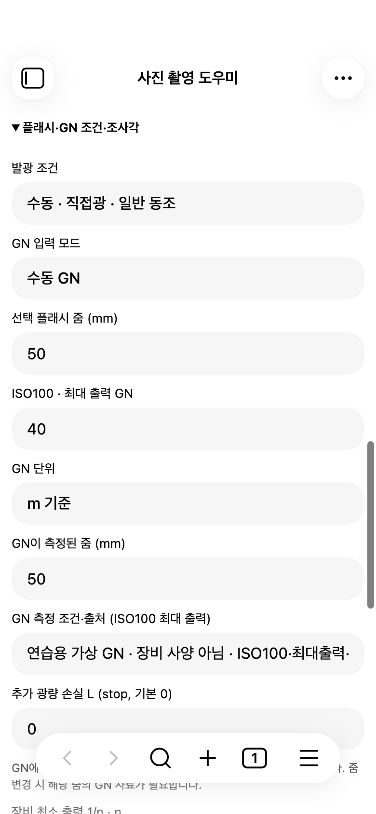
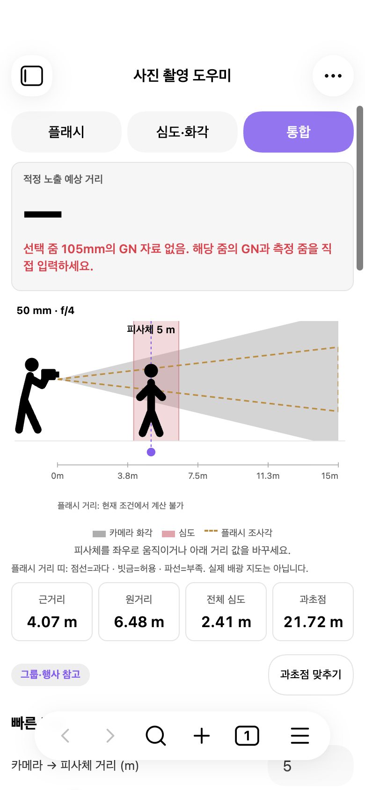
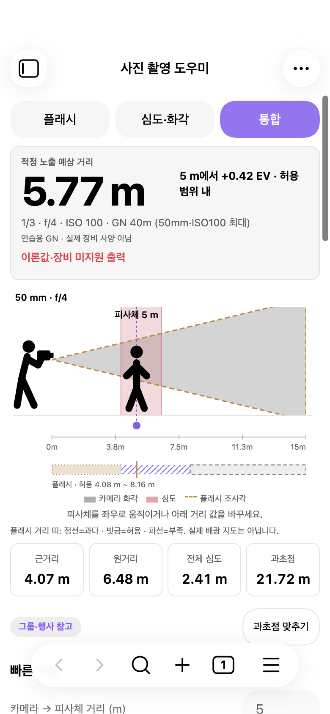
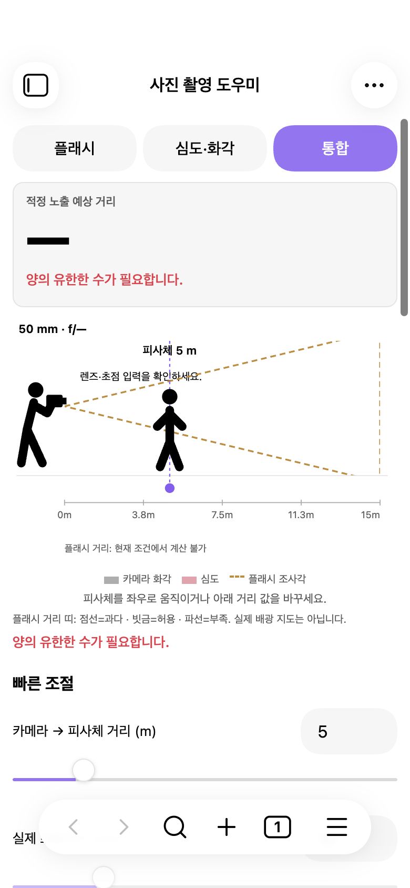
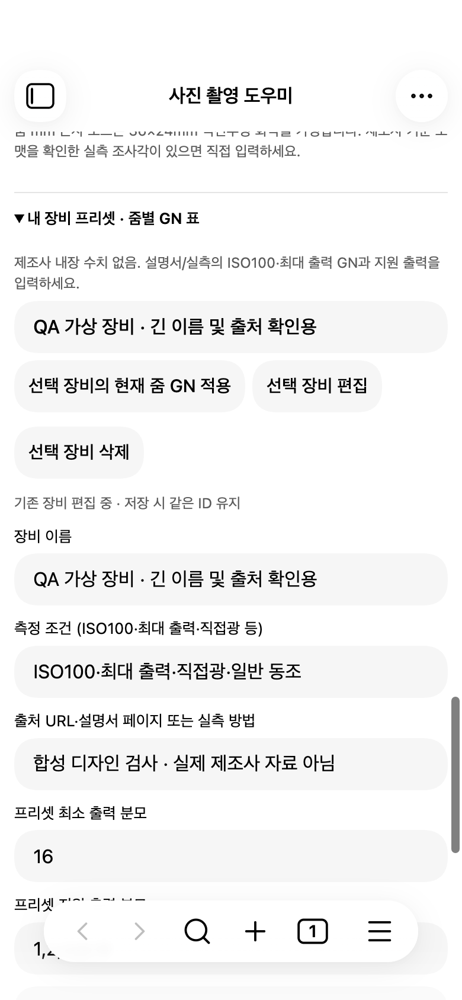
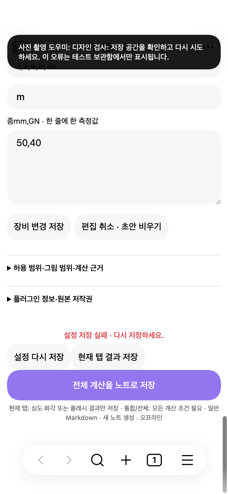
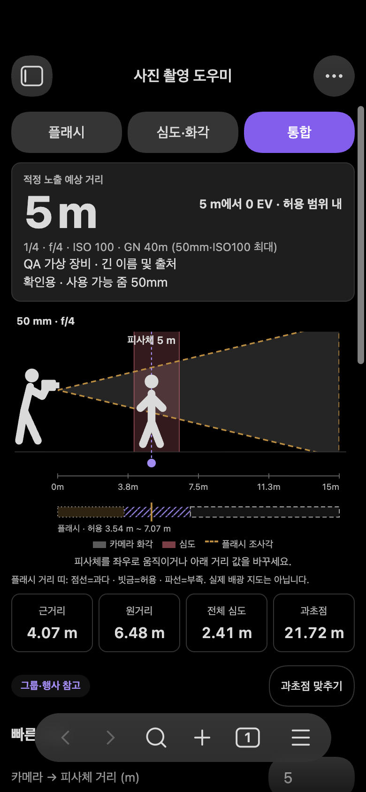

# 모바일 디자인 탐색 · 2026-10-29

## 범위와 상태

1.2.0 preparation의 현재 작업 트리와 `docs/preparation/REPORT.md`, Codex 공통 AGENTS.md를 읽고 시작했다. GN 소수 입력 커서/탭별 저장 수정은 보존했다. 이번 단계는 **현재 화면 점검과 이미지 시안 제안만**이며 src, styles.css, main.js, manifest, 계산 엔진, 저장 형식을 바꾸지 않았다. 공개 배포·실사용 보관함 교체 없음.

별도 `/private/tmp/photo-field-qa-vault`에서 현재 main.js의 SHA256이 프로젝트 빌드와 같은지 확인하고 실행했다. macOS Obsidian1.14.5 Chromium 모바일 에뮬레이션, 논리 뷰포트390×844, 실제 캡처780×1688. 실제 iOS/Android 검증이 아니다. 테스트용 상태와 가상 장비만 사용했고 캡처 후 QA의 기존 저장 상태를 복원했다. 사용자의 실사용 노트·프리셋을 읽거나 변경하지 않았다.

세 시안의 공통 조건: 풀프레임36×24mm, 실제50mm, f/4, ISO100, 온카메라5m, GN40m(ISO100 최대·측정/선택 줌50mm), 출력1/4, 손실0, CoC=대각/1500, 그림 범위15m. 예상5m/0EV, 심도4.07–6.48m·전체2.41m, 과초점21.72m. GN40은 연습용이며 실제 장비 사양이 아니다.

## 현재 화면 점검

아래 캡처는 이번 작업에서 실제 플러그인을 실행해 얻은 화면이다. 이미지 생성 시안과 구분한다. 기준 뷰포트와 상태별 보이는 문구는 `capture.json`에 기록했다. 캡처의 앱 기본 상단/하단 막대는 Obsidian 호스트 영역이다.

| 단계 | 상태·전반 평가 | 확인한 강점 | 개선 기회·근거 |
| --- | --- | --- | --- |
| 01 | 통합 · 장면 유지 양호, 조작 우선순위 개선 필요 | 사진가·피사체·화각·심도와 거리 수치를 한 장면에서 확인 | 결과 패널/장면/범례·설명/심도4카드/보조 버튼 뒤에 빠른 조절 시작. 자주 쓰는 거리·조리개·출력은 첫 화면 아래로 밀림 |
| 02 | 플래시 · 계산 읽기 양호 | 예상 거리/EV/조건이 같은 묶음 | 예상 거리 숫자와 단위의 강조가 비슷하고, 플래시 우선 탭에서도 초점거리 조작이 출력보다 먼저 나옴. 장면은 유지하되 조작 순서의 맥락화 필요 |
| 03 | 심도·화각 · 핵심 경험 양호 | 장면과 근·원거리·전체·과초점 제공, 플래시 결과 숨김 | 통합과 같은 긴 빠른 설정 구조. CoC/렌즈 관련 조작과 비관련 출력·ISO의 우선순위 구별 필요. 카드4개는 숫자가 길면 밀도 증가 가능 |
| 04 | 펼친 GN 설정 · 기능 명확, 입력 흐름 길음 | 측정 줌/선택 줌·단위·조건·손실을 구분 | 단일 열 전체 폭 입력칸이 반복되어 스크롤이 길다. 짧은 수치와 단위, 긴 조건/출처를 같은 형태로 다룸. 연관된 GN·단위·줌을 묶을 여지 |
| 05 | 줌GN 자료 없음 · 오류 노출 양호 | 거리 대신 —, 해당105mm 자료 없음과 수정 행동을 안내. 유효한 심도는 유지 | 오류가 긴 붉은 문장으로 큰 결과 공간을 차지. 수치 부재·이유·해결 방법의 구분을 정돈할 여지 |
| 06 | 미지원1/3 · 의미 노출 양호 | 이론값·장비 미지원 출력을 명시하고5.77m/+0.42EV 표시 | 계산 가능한 이론값과 계산을 막는 오류가 같은 붉은 강조. 경고/오류 문구·아이콘·배경 역할을 나눌 여지 |
| 07 | 빈 조리개 · 잘못된 결과 방지 양호 | 거리·광학 결과를 비우며 — 표시 | ‘양의 유한한 수’라는 일반 오류와 장면의 렌즈·초점 안내가 중복. ‘조리개를 입력하세요’ 같은 필드 중심 표현의 기회. 이번에는 코드를 바꾸지 않음 |
| 08 | 장비 편집 · 보존 정보 명확 | 기존 장비 편집/ID 유지, 조건과 출처 필드가 실제로 제공됨 | 적용·편집·삭제 버튼이 비슷한 강조. 긴 이름·출처가 한 줄 입력에서 잘려 전체 확인을 위해 이동 필요. 선택 장비와 작성 초안을 시각적으로 분리할 여지 |
| 09 | 설정 저장 실패 · 재시도 제공 | 화면에 실패와 ‘설정 다시 저장’ 존재, 두 노트 저장 기능도 유지 | 설정 재시도와 탭 저장 버튼이 이웃하고 전체 저장만 크게 강조되어 서로 다른 저장 목적이 섞임. 실제 디스크 장애를 새로 만든 것이 아니라 테스트용 오류 표시 함수를 호출해 캡처한 상태 |
| 10 | 다크·긴 장비명 · 내용 유지 | 긴 이름은 결과 영역에서 줄바꿈됨 | 장비명이 길어지면 결과 블록 높이가 커져 장면/조작이 더 내려감. 다크의 표면 구분·보조 글씨 대비를 토큰으로 일관되게 설계할 여지 |

### 실제 화면

01 통합:

02 플래시:

03 심도·화각:

04 펼친 설정:

05 GN 자료 없음:

06 이론 출력:

07 빈 입력:

08 장비 편집:

09 설정 저장 실패 표시(테스트 주입):

10 다크·긴 장비명:

## 참고 자료와 적용할 원칙

외부 화면·아이콘·폰트를 제품 자산으로 복사하지 않는다. 참고 자료는 시각적 구성 원칙을 비교하기 위한 것이다. 생성 도구에는 현재 앱 캡처를 실제 참조 이미지로 첨부했다.

- [Halide Mark III 공식 디자인 설명](https://www.lux.camera/halide-mark-iii/#the-new-design): 모든 도구에 동일한 중요도를 주지 않고 주요 촬영 조작을 먼저 노출하는 원칙. 유리 효과는 사용자의 기준에 따라 채택하지 않는다.
- [Halide 공식 소개](https://www.lux.camera/introducing-halide/): 어두운 촬영 표면과 절제된 조작부. 공식 공개 이미지를 열어 확인했다. 카메라 촬영 버튼·실시간 뷰파인더 같은 다른 제품의 기능은 가져오지 않는다.
- [Leica FOTOS 공식 페이지](https://leica-camera.com/en-int/photography/leica-apps/leica-fotos): 공식 화면을 직접 열어 어두운 배경, 억제된 테두리, 콘텐츠 중심 구성 관찰. Leica 상표·카메라 모델을 플러그인 사양처럼 넣지 않는다.
- [PhotoPills 공식 사용자 가이드](https://www.photopills.com/user-guide-2#step12): 촬영 조건과 심도 결과의 연결, 수치/그림 전환 설명을 확인하고 가이드에 포함된 계산 화면도 열어 보았다. AR·지도·실측 기능은 추가하지 않는다. 참고 화면만 `screenshots/reference-photopills.png`에 기록했다.

## 세 디자인 방향

최종 세 이미지는 별도 `CONCEPTS.md`에서 동일한 프레임으로 비교한다. **실행 화면이 아닌 이미지 시안**이다. 이미지의 도형은 측정 가능한 광학 증거가 아니며 구현 시 기존 계산 엔진과 SVG 좌표를 그대로 기준으로 삼는다.

| 방향 | 차별점 | 장점 | 주의점 |
| --- | --- | --- | --- |
| A 정밀한 카메라 도구 | 차콜·세이지, 수치→장면→정돈된 조작부 | 거리·EV를 빠르게 읽고 반복 조작하기 좋음 | 밝은 야외에서 대비 확인 필요, 장면 비중을 줄이지 않도록 유지 |
| B 밝은 미니멀 도구 | 따뜻한 중성 배경, 장면→가벼운 결과 행, 선·여백 중심 | 긴 설명과 장비 편집까지 부담 없이 확장하기 좋음 | 보조 선·조사각·밴드가 희미해지지 않도록 대비 확인 필요 |
| C 시각적 촬영 시뮬레이터 | 큰 장면, 파랑 화각·분홍 심도·황색 점선 플래시, 장면 아래 결과 연결 | 값을 바꾸면 장면이 바뀌는 원본 경험이 가장 선명함 | 겹치는 의미와 색 의존을 줄이고, 여러 카드로 다시 분절하지 않도록 주의 |

추천은 **C**. 원본 장면 경험을 유지하면서 거리·조리개·출력을 장면 가까이에 묶는 방향이 이번 목표에 가장 가깝다. A는 야간 촬영 도구 느낌, B는 밝고 차분한 일상 도구 느낌을 선호할 때 적합하다. 최종 선택 전 적용하지 않는다.

## 선택 후 구현할 공통 규칙

색·간격·타입·모서리·컨트롤 높이는 플러그인 범위 CSS 변수로 정리하고 Obsidian 테마와 연결한다. 라이트/다크는 각각 대비·표면·선 역할을 검토한다. 고정 하단 패널은 기본안에서 피하고 호스트 도구막대·키보드·안전영역을 실제 화면으로 검증한다. 시스템 폰트·기존/직접 만든 로컬 SVG만 사용한다.

통합은 장면과 플래시·심도 관계를 우선하고, 플래시는 예상 거리/EV/출력을, 심도 탭은 장면/초점거리/조리개/CoC를 우선한다. 전체 설정은 펼쳐 접근 가능하게 유지한다. 상세 GN 출처는 접어둘 수 있지만 모드·온/오프카메라·이론 출력·자료 없음·저장 실패는 요약 상태와 텍스트로 표시한다. 오프카메라에서 기존 별도 축과 공간 중첩 불가 설명을 유지한다.

탭 저장과 전체 저장을 분명하게 나누되 계산·저장 데이터 구조는 바꾸지 않는다. GN40.5 입력/포커스/커서·초안·저장 병합 보존,360/390세로·가로·큰 글씨·긴 이름/오류,44px 터치, 드래그/스크롤/슬라이더/사이드바와 관련 모바일 시나리오는 실제 구현 후 다시 검사한다.

## 검증 한계

이번 단계는 기존 앱 상태 캡처와 이미지 탐색이다. 새 디자인의 터치 크기·키보드·포커스·스크롤·실기 접근성 통과를 주장하지 않는다. 정상/오류 화면 관찰만으로 WCAG 준수를 확정하지 않는다. 기존 자동 테스트는50/50 통과(`unit-results.txt`); 제품 코드 변경이 없어 전체 모바일 회귀를 반복하지 않았다. 실행 화면과 최종 시안의 값은 같은 기준으로 맞추지만, 생성 이미지의 픽셀 도형을 계산 검증에 사용하지 않는다.
