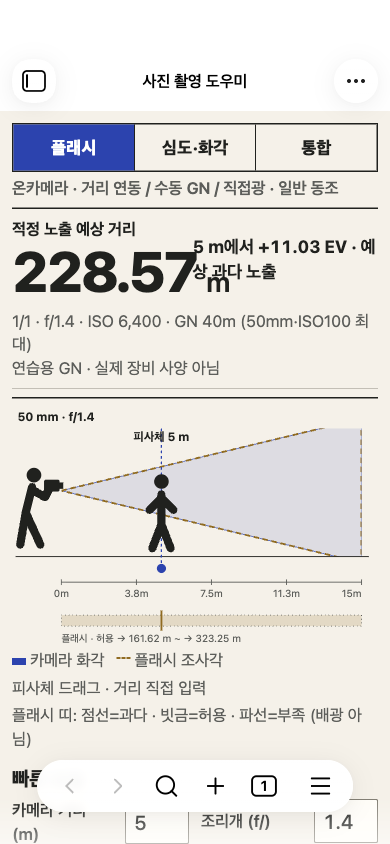
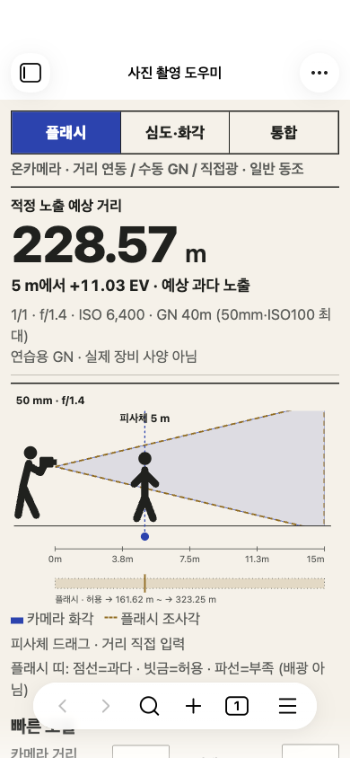
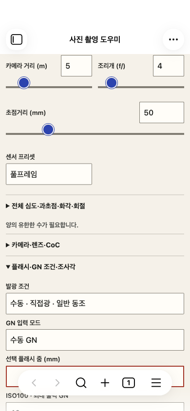
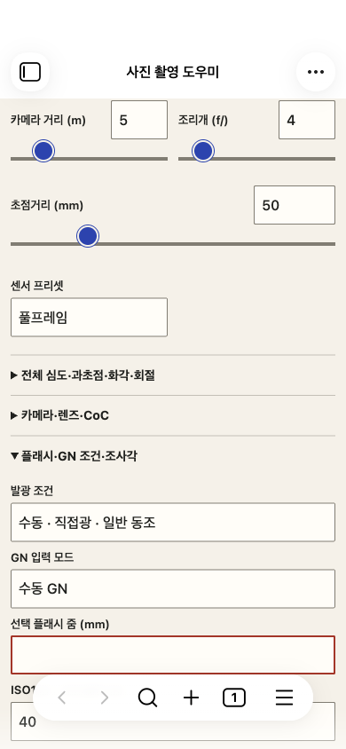

# 모바일 재현 검사와 수정 · 2026-10-29

**실제 모바일 에뮬레이션 조작에서 두 제품 문제를 재현하고 수정했다.** 이전 검사의 ‘새 버그 미발견’은 검사한 조건에 한정된 결과였고, 내부 글자 겹침과 미사용 입력의 오류 노출을 놓쳤다. 사용자에게 추가 재현 정보를 요구하지 않고 전용 테스트 환경에서 찾았다.

기준 `bcb428b`, 시작 작업 트리 깨끗함. 버전1.2.0 유지. 바우하우스·장면 중심 구성 및 기존 preparation 수정을 보존했다. 실기·새 설치·실사용 보관함 변경·push·공개 배포 없음.

## 1. 큰 결과 숫자가 EV 문구와 겹침

- 재현:390×844,20px CSS 글씨, 플래시 탭, 연습용 수동 GN40m·ISO6400·f/1.4·최대 출력. 예상 거리228.57m가 옆 ‘5m에서+11.03EV’ 문구와 겹쳤다.360px·기본 글씨에서도1,828.57m 같은 긴 결과에 재현됐다.
- 영향: 숫자·단위·노출 판단을 구별하기 어렵다. 루트 가로 넘침은 없어 이전 넘침 검사만으로 잡히지 않았다.
- 수정: 결과 패널의 고정 두 열을 줄바꿈 가능한 배치로 변경. 숫자가 길면 EV를 다음 줄로 보내고 숫자 아래 간격 확보. 일반5m 결과는 기존처럼 나란히 표시한다. 숫자 축소·절삭이나 계산 변경은 없다.
- 근거:4개 크기×2개 테마×2개 글씨 크기×3개 노출 조건=48개 조합에서 수정 전18개가 글자 사각형 겹침으로 실패. 수정 후0개. 기대 조건은 동일하며 글자/단위와 EV의 실제 좌표를 비교한다.

| 수정 전 | 수정 후 |
| --- | --- |
|  |  |

## 2. 심도 탭에 미사용 플래시 오류가 표시됨

- 재현: 기본 광학 조건 유지→플래시 설정의 줌 전체 삭제→심도·화각 탭. 심도 근거리4.07m는 유효하지만 ‘양의 유한한 수가 필요합니다’라는 플래시 조사 범위 오류가 상세 결과 아래 표시됐다.
- 영향: 현재 심도 계산이 잘못됐거나 저장할 수 없는 것으로 오해할 수 있다.
- 수정: 조사 범위 비교의 정상 패널과 오류에 같은 범위 클래스를 적용하고 심도 탭에서 제외. 통합 탭에서는 오류를 유지하며 ‘프레임·조사 범위 비교:’ 출처를 명시했다. 유효 광학/플래시 오류 자체를 감추거나 전체 저장 검증을 완화하지 않았다.
- 확인: 동일 조건에서 심도 탭의 불필요 오류 없음·근거리4.07m 유지. 심도 탭 Markdown 저장 가능. 전체 저장은 거부. 조리개를 비우면 실제 심도 오류는 계속 표시되고 심도 저장도 거부.

| 수정 전 | 수정 후 |
| --- | --- |
|  |  |

## 검사 환경과 범위

실제 macOS Obsidian1.14.5 ItemView, `/private/tmp/photo-field-qa-vault`, 별도 `/private/tmp/photo-field-qa-profile`, CDP9338. 페이지의 실제 보관함 경로를 먼저 확인하고 현재 번들을 복사했다. `app.emulateMobile(true)`·CDP 모바일 메트릭·터치 이벤트 사용.360×800·390×844·430×932·844×390, 라이트/다크, 기본/20px 글씨와 축소 높이를 검사했다.

새 회귀 검사에서 수정 전 번들은 두 문제를 모두 잡았고(4개 중2개 실패), 수정 후4개 모두 통과했다. 스크린샷은 같은 입력·크기에서 새로 캡처하고 직접 열어 확인했다. 초기 캡처 시간 초과는 전용 창의 최소화 상태 때문이었다. 그 창만 복원해 해결했고 실패 출력도 보존했다. 첫 전체 회귀에서는 기본 화면의 결과 위치 제한을4px가량 초과해 간격을 추가 조정했다. 테스트의710px 기준을 완화하지 않고 최종 재검사에서 통과했다.

이 결과는 **macOS Obsidian 모바일 에뮬레이션**이다. 실제 iOS·WKWebView·네이티브 키보드·노치·OS 뒤로가기 검증으로 표현하지 않는다. 실기 확인은 이번 완료 조건이 아니다.

## 최종 회귀 결과

| 실행 | 통과 |
| --- | ---: |
| 새 mobile-followup |4 (내부 결과 배치48조합 포함) |
| 기존 mobile / scene / swipe |17 /10 /6 |
| stabilization / preparation |14 /10 |
| bauhaus / mobile-host-qa / note-style-qa |6 /5 /1 |
| 실제 Obsidian 시나리오 합계 |73 |
| 자동 검사 |53 |
| 실제 번들·API 대역 통합 |15 |
| strict 타입 검사·빌드·diff 검사 |통과 |

GN40.5/40.25 커서·소수 입력, 피사체 CDP 터치·슬라이더·세로 스크롤·양방향/가장자리 스와이프, 일반 노트 제스처·CSS 격리, 장비·줌·출력·초안·복원·저장 실패/재시도·탭/전체 Markdown·오프라인 회귀가 통과했다. 최종73개는 [runs/summary.json](runs/summary.json)과 [새 결과](after/results.json)에 나뉘어 있다. 자동 결과는 runs/unit-tests.log, 대역 결과는 runs/bundle-integration.json. 과거 보고서와 캡처는 덮어쓴 채 남기지 않았다.

## 변경 파일·복구·설치 후보

- `styles.css`: 결과 내부 배치와 심도 탭의 조사 비교 표시 범위.
- `src/view.ts`: 조사 비교 오류의 클래스·출처 문구.
- `main.js`, `docs/build-meta.json`: 현재 소스의 빌드 결과.
- `tests/mobile-followup.mjs`: 실제 앱의 두 재현 조건 및 Markdown·GN 커서 회귀.
- 검증 문서·수정 전후 캡처·로컬 후보/복구 ZIP.

계산 엔진·노트 형식·저장 스키마·의존성·버전·라이선스는 기준 커밋과 동일하다. 최소1.7.4 선언도 기존 API/공식 앱 코드 근거를 유지하며1.7.4 실행 검증을 추가하지 않았다. 사용자 설정·장비·노트는 설치 후보에 포함하지 않았다.

설치 후보: [photo-field-mobile-1.2.0-mobile-fix-bcb428b.zip](../../dist/photo-field-mobile-1.2.0-mobile-fix-bcb428b.zip). SHA256 `0e726620ef1de7910632ee6a7b90168a99d485bc5a7d00a224fb0487fa3a6085`.

복구: [photo-field-mobile-1.2.0-bcb428b-recovery.zip](../../dist/photo-field-mobile-1.2.0-bcb428b-recovery.zip). 설치한 테스트 보관함의 플러그인을 끄고 복구 ZIP의 main.js·manifest.json·styles.css 세 파일만 함께 되돌린 뒤 다시 켠다. data.json·노트는 삭제/교체하지 않는다. 수정 전 소스/번들은 before/에도 보존했다.

ZIP 허용 파일 목록·내부 바이트와 현재 main.js/manifest/styles 일치를 전부 검사했고 MIT 전문·고지도 포함했다. [패키지 검증](packages.json), [설치 번들/소스 보존 검증](file-verification.json), [체크섬](SHA256SUMS). 실사용 설치나 공개 배포는 수행하지 않았다.
