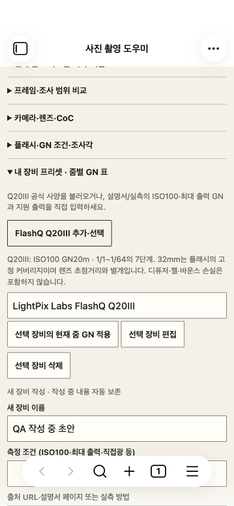
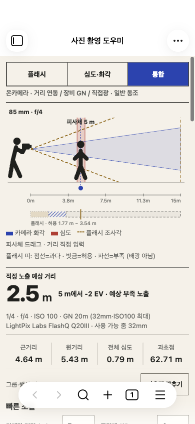

# FlashQ Q20III 공식 사양 프리셋 · 2026-10-29

사용자가 자신의 플래시 모델을 Q20III로 지정하여 LightPix Labs의 FlashQ Q20III 공식 자료를 확인하고 프리셋을 추가했다. 앞선 모바일 UI 수정이 있는 미커밋 작업을 그대로 보존했다. 실사용 보관함에 설치하거나 사용자 데이터를 수정하지 않았다.

## 출처와 입력값

- [제조사 제품 사양](https://www.lightpixlabs.com/pages/q20iii): GN20·ISO100,35mm판32mm 커버리지,1/1~1/64의7단계.
- 제품 페이지가 직접 연결하는 [공식 영어 Quick Manual](https://cdn.shopify.com/s/files/1/0663/3769/files/Q20III_quick_manual_EN_3_web.pdf?v=1731227259), [공식 한국어 설명서](https://cdn.shopify.com/s/files/1/0663/3769/files/Q20III_quick_manual_KR_2_web.pdf?v=1734002509). 제조사 설명서의 GN 단위는 m이다.
- 저장값: `{32:20}`(m), 최소 출력 분모64, 지원 분모 `1,2,4,8,16,32,64`.32mm는 고정 커버리지의 기준이며 조절식 줌이나 카메라 렌즈 초점거리가 아니다. 다른 줌의 GN을 추정하지 않는다.
- 제조사 공칭값이며 사용자의 기기를 실측/보정한 값이 아니다. 직광·일반 동조 계산에 사용한다. 디퓨저·젤·바운스의 추가 손실은 미측정이다. LED의60lux 사양을 플래시 GN으로 변환하거나 노출 계산에 섞지 않았다. TTL/HSS/바운스 모델 추가 없음.

## 사용하는 방법

새 후보에서 **내 장비 프리셋 → FlashQ Q20III 추가·선택**을 누르면 장비가 저장되고 선택되며 플래시 기준32mm·GN20과7단계 출력이 적용된다. 카메라 렌즈·ISO·조리개·거리·추가 손실·발광 방식은 임의 초기화하지 않는다. 기존 발광 방식이 미지원 조건이면 계속 명시적으로 미지원이다.

동일한 공식 프리셋은 중복 추가하지 않는다. 기존에 편집한 Q20III나 다른 장비를 덮어쓰지 않으며 작성 중 초안·수동 GN 기록도 보존한다. 삭제한 장비를 앱 시작 때 자동 재삽입하는 방식은 사용하지 않는다. 인터넷 연결은 불러오기에 필요하지 않으며 출처 URL은 장비 및 Markdown에 기록되는 문자열이다.

## 계산/실측 구분

| 항목 | 기록 |
| --- | --- |
| 장비·GN 출처 | LightPix Labs FlashQ Q20III, 제조사 공칭 GN20m·ISO100·32mm |
| 예시 조건 | ISO100·f/4·직광·일반 동조·추가 손실0 |
| 예상 거리 | 최대5m /1/2출력3.54m /1/4출력2.5m /1/8출력1.77m /1/16출력1.25m /1/32출력0.88m /1/64출력0.63m |
| 사용자 측정/사진 관찰 | 미제공 |
| 오차 | 실측이 없으므로 산정하지 않음 |
| 미확인 조건 | 사용 기기의 편차, 실제 배광, 액세서리 손실, 주변광·피사체 반사율 |

위 거리는 기존 GN 공식의 계산 예상값이며 실제 밝기·절대 조도 측정값이 아니다. 사진 겉보기 밝기로 GN을 자동 보정하지 않는다.

## 검증

- `npm run build`와 자동55개 통과. 신규2개는7단계/거리·출처·렌즈 독립성·지원 밖 줌 및 기존 장비/초안/수동값·편집본·복원 보존을 검사한다.
- 실제 macOS Obsidian 모바일 에뮬레이션에서 신규3개 통과: CDP 터치로 추가·선택, 반복 추가 방지·초안 보존,7단계 실제 선택/거리, 렌즈85mm에서도 GN20 유지, 플래시 기준을50mm로 바꾸면 자료 없음,1/128 이론 출력, 실제 Markdown·플러그인 재활성화 후 복원.
- 관련 기존 preparation10·stabilization14·mobile-followup4·mobile17·swipe6·mobile-host-qa5 =56개 통과. 자동55개와 별도이며 실제 iOS 통과가 아니다.
- 초기 UI 검사에서 닫힌 GN 설정을 펼치지 않은 테스트 단계가 실패했다. 실제 펼치기 조작을 추가하여 재검사했고 기대값은 완화하지 않았다. 첫 기록도 보존했다.
- [UI 결과](ui-results.json), [회귀 결과](runs/summary.json), [테스트 설치 파일 일치](installed-verification.json). 아래 새 캡처를 직접 열어 확인했다. 기존 검사 산출물은 이번 실행 폴더로 분리 보존했다.

## 변경·후보·복구

`src/presets.ts`에 공식 프리셋 추가/선택, `src/view.ts`에 버튼·안내를 추가했다. 새 테스트2개 파일과 문서/캡처가 추가됐다. 기존 계산 엔진·저장 형식·기존 UI 수정·버전1.2.0·최소1.7.4·라이선스 유지. 새 의존성·외부 폰트·런타임 네트워크 없음.

현재 소스와 앞선 모바일 두 수정이 함께 들어간 [설치 후보 ZIP](../../dist/photo-field-mobile-1.2.0-q20iii-candidate.zip)을 만들었다. main.js·manifest.json·styles.css 및 원본 라이선스/고지의 ZIP 내부 바이트를 모두 확인했고 개인 설정·노트·장비 data.json은 포함하지 않았다. [체크섬](SHA256SUMS), [패키지 검증](packages.json).

[Q20III 추가 전 복구 ZIP](../../dist/photo-field-mobile-1.2.0-before-q20iii-recovery.zip)은 이전 모바일 UI 수정은 유지한다. 테스트 보관함에서 플러그인을 끄고 main.js·manifest.json·styles.css만 함께 복구한 뒤 다시 켠다. data.json·노트는 교체하거나 삭제하지 않는다. 소스/번들의 시작 상태는 before/에도 보존했다. 공개 배포·push·실사용 설치는 하지 않았다.
