# 사진 촬영 도우미 1.3.4 설치 후보 · 현장 사용성 개선

기준: 2026-11-02, 로컬 HEAD와 원격 main 모두 `242c5970c69cf773ce5ca855521fed7dac6fd566`, 1.3.3. Codex 공통 AGENTS와 Product Design audit/user-context 지침을 읽었다. 기존 미추적 `docs/zone-focus/brat-repair/`, `brat-update-check.json`을 보존했다. 최초 후보 검증 이후 사용자가 실사용 설치와 GitHub 공개 릴리스를 모두 승인했다. 배포 결과는 DEPLOYMENT.md에 기록한다.

## 확인한 마찰과 변경

1. **높음 — 권장 출력 확인 후 출력 선택을 다시 찾아야 함.** 상세 표 안에 있던 권장 지원 단계와 잔여 EV를 현재 거리의 노출 결과 아래로 옮겼다. `권장 출력 1/n 적용`은 계산 도구의 출력값만 변경한다. ISO·조리개·거리에는 손대지 않는다. 적용 후 실제 출력과 현재 EV가 즉시 갱신되며 `출력 적용 취소 · 1/n로`로 이전 출력만 복원한다. 장비 삭제 복구와 구별된다. 권장값은 기존 `flash()`의 nearest/residual/status를 그대로 사용한다. 최대·최소 한계와 미지원 이론 출력, GN 누락을 숨기지 않는다. 계산 불가 시 버튼이 비활성화되고 플래시 조건으로 이동할 수 있다.
2. **높음 — 상세 설정에서 결과로 수동 스크롤 복귀.** 카메라·플래시·장비·고급 설정 끝에 `결과로 돌아가기`를 추가했다. 기존 바로가기와 펼침 상태를 유지한다. 상단에는 센서·실제 렌즈 mm·조리개와 관련 탭의 ISO·플래시 장비/조건을 표시한다. 심도·존 탭에서는 무관한 플래시 요약을 제외했다. 입력 중 자동 이동이나 새 고정 영역은 없다.
3. **높음 — 존 목표와 역산 결과 사이에 전문 설정이 끼어 있음.** 질문 형태로 현재 확인/목표 역산을 구별하고 존 패널을 빠른 조절 앞에 배치했다. 목표 근거리·원거리/무한대 → 역산 결과·현재값에서 변경값 → 적용 → 렌즈 제한 순서다. 제한과 사용 단계는 접힌 상태로 접근하며 CoC 설정 연결을 제공한다. 달성 불가 시 제한 확인 버튼으로 연결하며 목표·렌즈 제한을 자동 변경하지 않는다. 적용 후 현재 설정으로 목표 포함 여부를 재계산한다.
4. **중간 — 환산 설명·저장 이름/대비.** `실제 35mm f/2 → 풀프레임 화각 52.5mm / 심도 약 f/3`를 우선하고 상세 계수·모델 설명은 기존 도움말 안으로 옮겼다. 실제 조리개로 노출/플래시 계산한다는 문장은 유지했다. 저장 이름은 현재 탭별로 바뀌며 저장 후 사용자가 원할 때만 노트를 열 수 있다. 저장 버튼 hover에서 배경과 글자색이 충돌하던 현상도 고쳤다.

## 같은 7개 흐름 비교

이 표는 **합성 QA 시나리오**다. 실제 사람을 모집한 연구나 소요시간 비교가 아니다. 기준은 390×844 라이트, GN40·50mm·ISO100·f/4·출력1/4에서 거리10m로 변경, 카메라 CoC0.025, 존 목표2–5m, APS-C35mm f/2 순서다. 촬영 장비는 합성 데이터다.

조작은 버튼 클릭·선택값 변경·숫자 필드 편집 각각 1회로 계산했다. 네이티브 선택창 열기/선택의 실제 손가락 탭 수는 측정하지 않았다. ‘입력’은 숫자 직접 편집 포커스 횟수이며 **실제 OS 키보드는 호출/측정하지 않았다**. 스크롤 왕복은 해당 작업에서 아래 영역으로 갔다가 결과로 돌아오는 논리 경로이며 캡처를 위한 추가 이동과 적용 취소 재검사는 제외했다. 실제 스와이프 횟수는 세지 않았다.

| 단계 | 수행·건강 상태 | 명시적 조작 전→후 | 스크롤 왕복 전→후 / 위치 | 숫자 입력 포커스 전→후 |
|---|---|---:|---|---:|
| 1 | 열어 조건 확인 · 개선 | 열기 1→1 | 0→0. 요약에 실제 렌즈·조리개·ISO·관련 장비 표시 | 0→0 |
| 2 | 거리10m로 변경·권장 찾기 · 개선 | 값 선택+상세 펼침 2→값 선택 1 | 결과→빠른 거리→상세 표가 결과→빠른 거리→결과로 바뀜. 3단계와 합산해 왕복1→1 | 0→0 |
| 3 | 권장1/1 적용·결과 확인 · 개선 | 출력 선택 1→적용 버튼 1 | 2–3단계 합산 영역 이동4구간→2구간. 상세 표에서 출력 선택으로 되짚는 경로 제거. 왕복 횟수 자체는 동일 | 0→0 |
| 4 | 카메라 CoC 변경·결과 복귀 · 개선 | 바로가기+방식 선택+편집 3→복귀 버튼 포함4 | 왕복1→1. 긴 수동 복귀1→명시적 결과 복귀1, 펼침 유지 | 1→1 |
| 5 | 존 목표 입력·적용 · 개선 | 탭+흐름 선택+입력2+적용 5→5 | 목표→적용은 아래 방향, 왕복0→0. 두 영역 간 간격576→326 CSS px | 2→2 |
| 6 | APS-C·실제35mm f/2·환산 읽기 · 개선 | 탭+센서+편집2 4→4 | 빠른 조절과 환산 사이 기존 왕복1→1. 관련 설명을 접어 읽는 양 감소 | 2→2 |
| 7 | 현재 심도 결과 노트 저장 · 개선 | 저장1→1 | 하단으로 편도, 왕복0→0. 완료 후 열기는 선택적 +1 | 0→0 |

2–3단계 합산 조작은 **3→2회**다. 스크롤 왕복 전체가 없어지거나 모든 흐름의 조작 수가 줄었다고 주장하지 않는다. 카메라 복귀는 버튼이 1회 늘지만 긴 수동 스크롤을 명확한 결과 이동으로 바꾼다. 존 목표 입력 상단→적용 버튼 상단 거리는 **575.77→325.78px(약43% 감소)**이며, 화면 내 DOM 좌표 차이를 측정한 값으로 사람의 이동 시간이나 손가락 스와이프 수가 아니다. 원자료: [전](before/measurements.json), [후](after/measurements.json).

## 같은 화면의 전후 캡처

모두 이번 작업에서 전용 실제 Obsidian ItemView를 조작해 저장했다. 아래 대표 캡처와 오류·큰 글씨·가로·축소 높이 캡처를 파일로 열어 직접 확인했다. 전체 행렬의 모든 이미지에 개별 수동 판독을 했다는 의미는 아니다.

| 화면 | 1.3.3 | 1.3.4 후보 |
|---|---|---|
| 1. 시작 조건 | 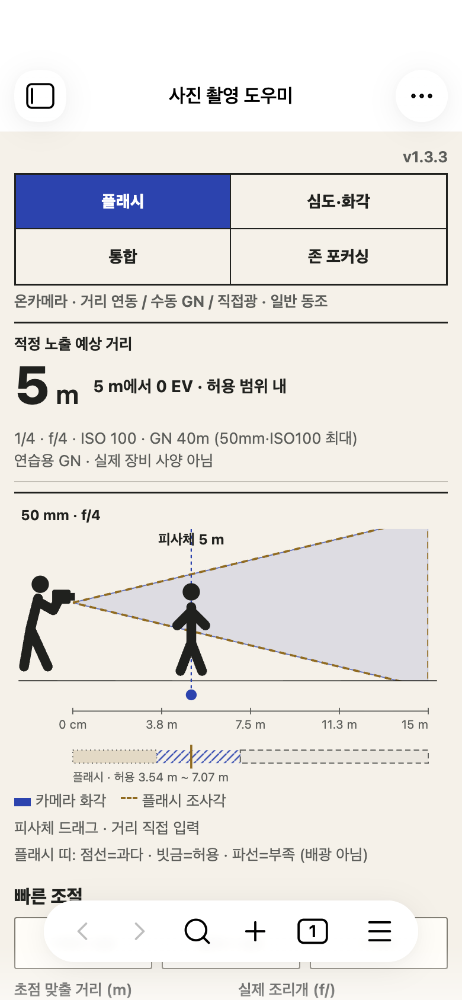 | 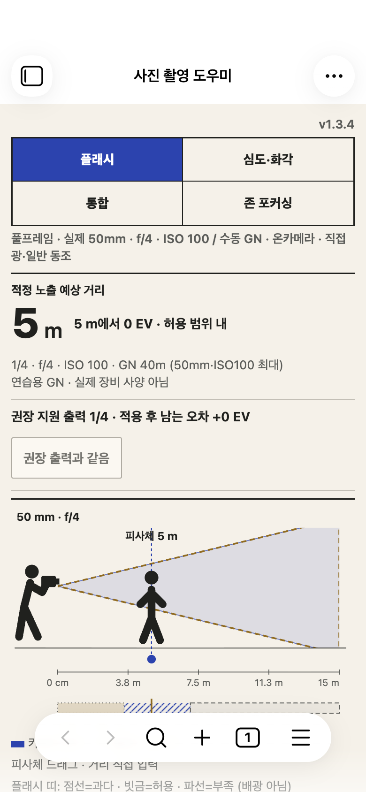 |
| 2. 같은 거리10m 결과 | 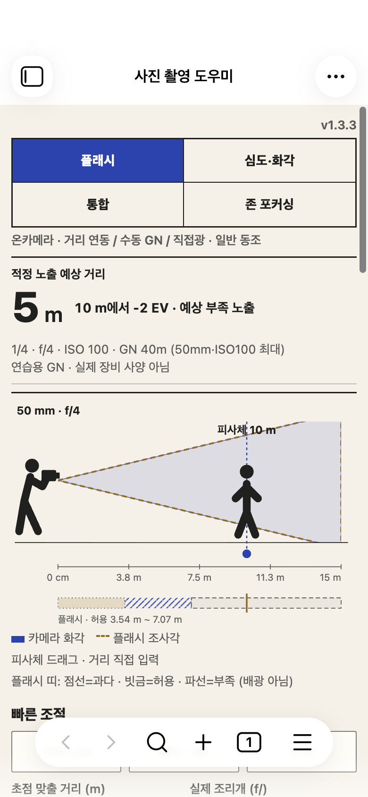 | 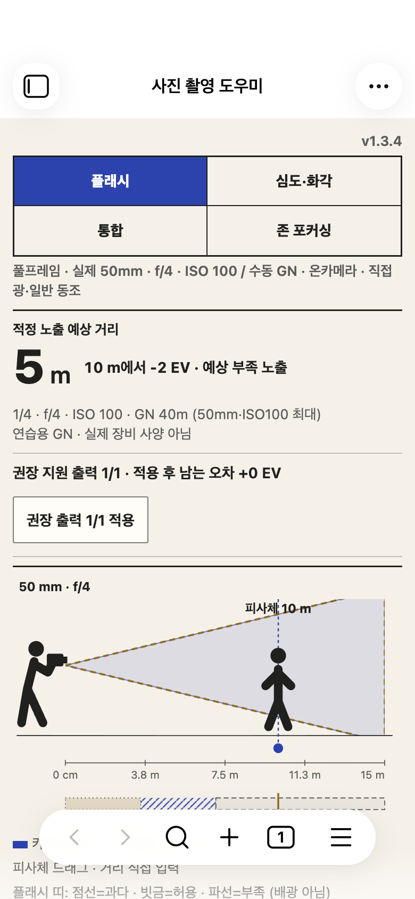 |
| 3. 출력1/1 적용 후 | 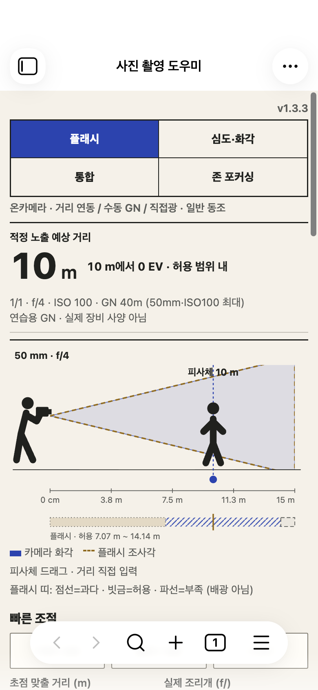 | 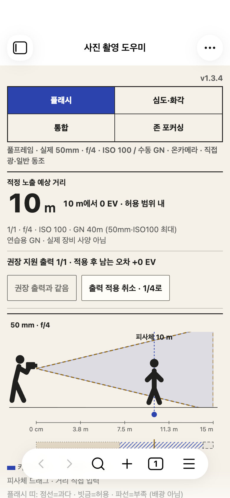 |
| 4. 카메라 상세 | 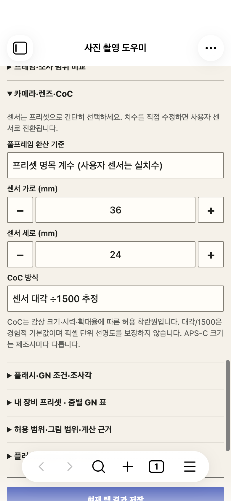 | 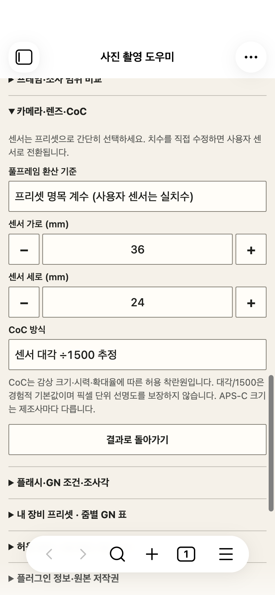 |
| 5. 목표2–5m 입력 후 | 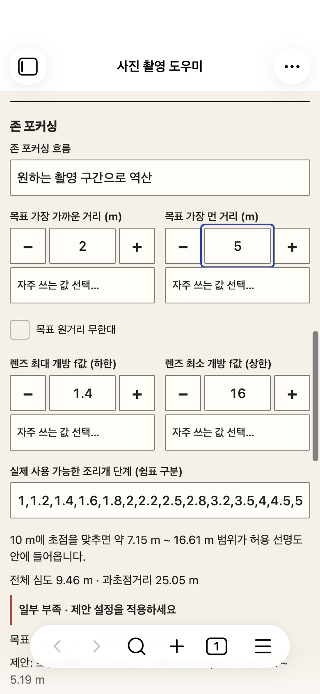 | 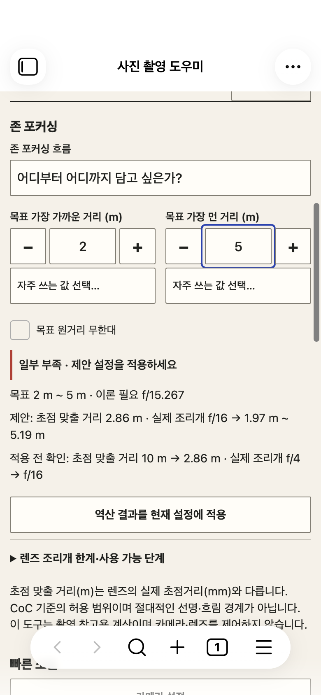 |
| 6. APS-C 환산 | 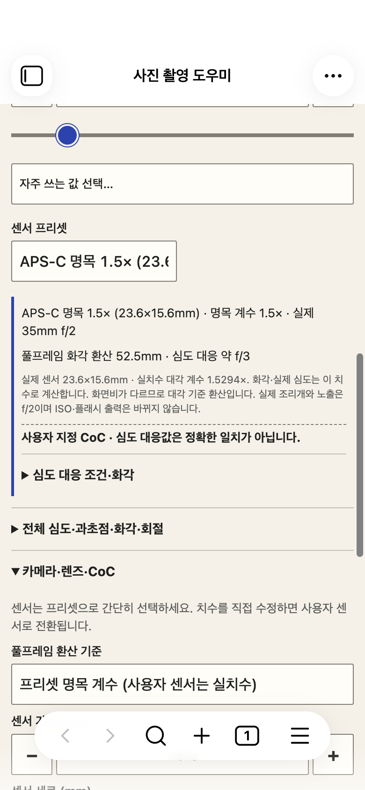 | 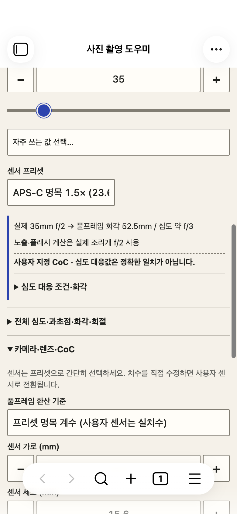 |
| 7. 저장 완료 | 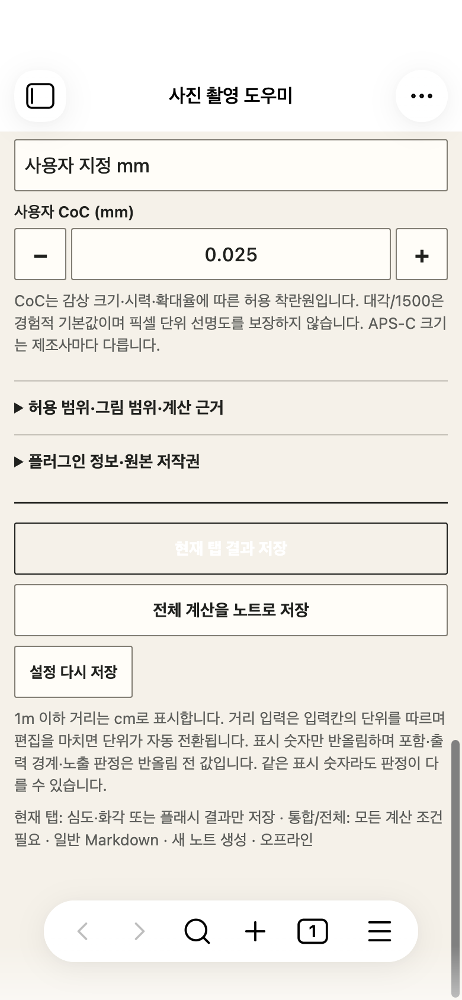 | 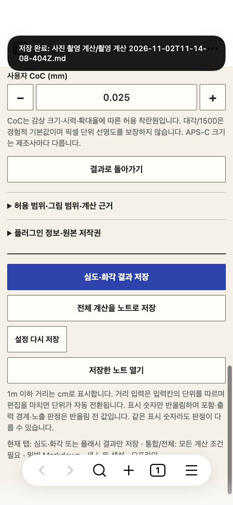 |

적용 후 [존 포함 확인](after/05-zone-applied.png), [달성 불가](after/zone-impossible.png), [긴 장비·이론 출력](after/long-equipment.png), [GN 누락](after/error-gn.png), [최대 출력 한계](after/flash-limit.png)도 확인했다. 축소 높이/큰 글씨에서는 상단에 모든 결과를 동시에 볼 수 없어 스크롤이 필요하다. 기존 Obsidian의 떠 있는 도구막대가 가로 장면이나 일부 콘텐츠 위를 지나가는 현상은 남는다. 해당 요소로 스크롤해 접근할 수 있으며 새 고정 UI는 추가하지 않았다.

## 검증과 보존

- `npm test`: **82/82** 통과. 계산 정확성·수치 경계·zone·cm/m·저장·디자인 계약 포함. `npm run build` strict 타입 검사와 번들 생성 성공. `git diff --check` 통과.
- `tests/field-usability.mjs`: **11/11 묶음** 통과. 7개 흐름, 출력만 적용·취소, 커서/포커스/스크롤, 상세 펼침 보존, 누락 GN·이론 출력·긴 장비·장비 한계·존 달성 불가, 실제 현재 탭/전체 노트 저장·명시적 열기·재진입 복원. 미처리 pageerror 0. 후보와 검사 파일 SHA256 일치.
- 화면 행렬: 360×800·390×844·844×390·390×440 × 라이트/다크 × 기본/20px 큰 글씨 × 4탭 = **64개 상태**. 가로 넘침 없음. 각 조합의 저장 버튼 44px 이상과 중앙 hit-test 확인. 대표 캡처에서 대비·잘림·장면 라벨을 직접 검토했다. 모든 상태를 한 화면에 동시에 보여준다는 뜻은 아니다.
- 기존 `distance-mobile.mjs` **4/4**, `settings-mobile.mjs` **5/5**, `stabilization.mjs` **14/14**, `swipe.mjs` **6/6**, `note-style-qa.mjs` **1/1** 통과. GN40.5→40.25 중간 삽입, cm/m100배 방지, 프리셋 초안/ID/삭제 복구, 120회 입력 저장 병합, 실패 재시도, 동시12노트 충돌 회피, 실제 CDP 터치 드래그·슬라이더·사이드바 보호, 일반 노트의 스타일/제스처 보존.
- 과거 stabilization 검사는 1.3.3에서 이미 접힌 출력 설정을 열지 않고 입력하려 했고, 중첩 summary도 둘 이상 선택했다. 이번 검사에서 그 순서를 수정했다. 최초/재시도 실패 로그는 지우지 않았고 최종 결과는 `regression/stabilization-final.txt`와 `regression/stabilization/after.json`이다.
- 계산 엔진·장비 사양·저장 스키마·일반 노트 CSS/제스처는 변경하지 않았다. 기존 바우하우스/장면/4탭·거리 단위·±/빠른 값·설정 바로가기·자동 숨김·탭별 Markdown 저장을 유지했다.

환경은 `/private/tmp/photo-field-qa-profile`과 `/private/tmp/photo-field-qa-vault`의 macOS Obsidian 1.14.5, `app.emulateMobile(true)`, Playwright/CDP 모바일 메트릭·터치 이벤트다. 실사용 보관함 데이터는 읽거나 테스트하지 않았다. **iOS/Android 실기 검증이 아니다.** 실기 키보드와 단위 전환·선택창·VoiceOver/TalkBack 읽기 순서·노치/회전·OS 뒤로가기/백그라운드 저장은 후속 확인 항목이다. 스크린샷만으로 접근성 준수를 보장하지 않는다.

## 후보와 승인

[1.3.4 설치 후보 ZIP](candidate/photo-field-mobile-1.3.4-candidate.zip) · [1.3.3 복구 ZIP](candidate/photo-field-mobile-1.3.3-rollback.zip) · [SHA256/패키지 대조](package-verification.json) · [설치·복구 방법](INSTALL.md).

ZIP에는 플러그인 코드3개와 라이선스만 들어 있고 `data.json`과 보관함 노트는 없다. 후보 검증 후 사용자가 실사용 설치와 GitHub 공개 릴리스를 모두 승인했다. 실사용 설치 시 플러그인을 백업하고 data.json을 유지하며 검증된 세 파일만 교체한다. 배포 결과는 [DEPLOYMENT.md](DEPLOYMENT.md)에 기록한다.

재현: `node tests/field-usability.mjs`; 기준 캡처는 `BASELINE=1 QA_SOURCE=<242c597의 main.js/styles.css/manifest.json 폴더> node tests/field-usability.mjs`. 기존 회귀는 `QA_OUT`으로 이번 릴리스 하위 경로를 지정해 이전 기록을 보존한다. 실행 로그와 원자료는 이 폴더와 `regression/`에 있다.
