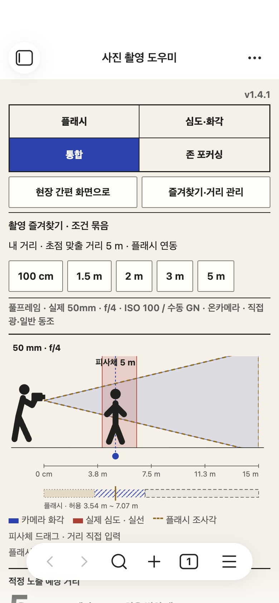
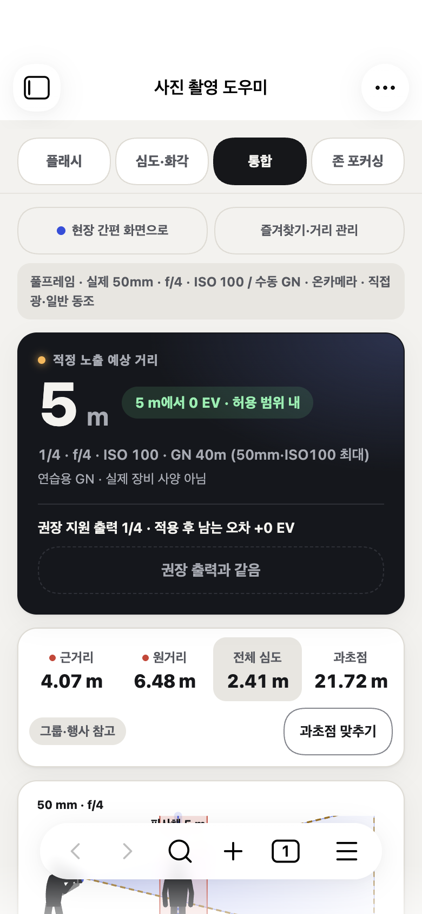
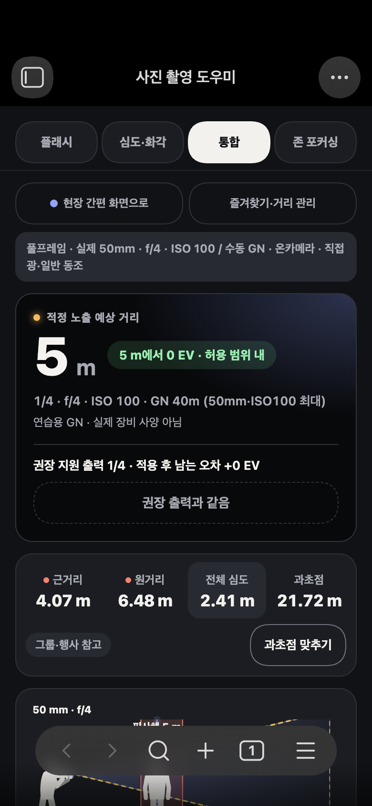
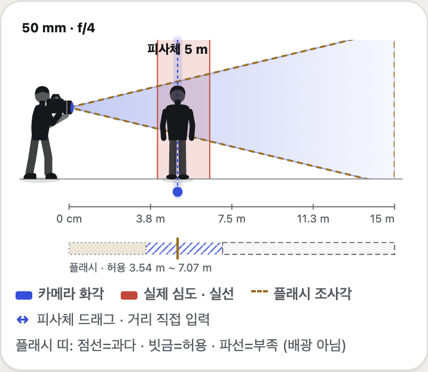

# 사진 촬영 도우미 1.5.0 · 모바일 화면 개편

모바일에서만 쓰는 도구라는 기준으로 화면 구성과 디자인을 다시 만들었습니다. 계산 엔진·데이터 형식·장비 사양은 1.4.1과 같습니다.

## 바뀐 점

- **답이 첫 화면에.** 탭 바로 아래에 플래시 적정 노출 예상 거리 카드가 있고, 이어서 근거리·원거리·전체 심도·과초점 숫자, 그다음 장면 그림이 나옵니다. 1.4.1에서는 이 값이 첫 화면 아래에 있었습니다.
- **한 줄 고정 탭.** 4개 탭이 한 줄로 화면 위에 고정됩니다. 아래쪽에서 탭을 바꾸면 결과 위치로 돌아갑니다.
- **상태를 색으로.** 노출 차이 배지는 허용 범위 내(초록)·예상 과다(주황)·예상 부족(하늘)로, 존 목표는 포함·일부 부족·달성 불가로 구분합니다. 문구와 판정 기준은 그대로입니다.
- **다이얼형 조절.** 이름과 값 입력이 한 줄, 그 아래 [−] 넓은 슬라이더 [+]. 슬라이더에 진행 표시가 있고 손잡이와 트랙 중심이 정확히 맞습니다. 자주 쓰는 값은 오른쪽 둥근 버튼에서 고릅니다.
- **선택 상태 표시.** 지금 거리와 같은 내 거리 칩, 적용 중인 촬영 즐겨찾기·존 목표가 강조됩니다. 즐겨찾기가 없으면 추가 위치를 안내합니다.
- **존 포커싱 탭**은 목표 입력·역산 결과가 즐겨찾기보다 먼저 나옵니다.
- **장면 그림.** 촬영자와 피사체를 새 실루엣(상의·하의·신발, 렌즈가 보이는 카메라)으로 다시 그리고 바닥 그림자·화각 그라데이션·초점면 강조를 넣었습니다. 직접 작성한 SVG이며 원본 자산을 쓰지 않습니다.
- 카드형 설정 목록, 토글 스위치, 저장 버튼 정리, 긴 표시·저장 안내는 접기로 이동.
- 플러그인을 끄거나 업데이트할 때 화면 칸을 닫지 않아 다시 켜면 같은 자리에서 복원됩니다.

## 화면

| 1.4.1 | 1.5.0 라이트 | 1.5.0 다크 |
|---|---|---|
|  |  |  |

장면: 

## 검증 범위

- strict 타입검사·빌드, 자동 95개 통과.
- 별도 macOS Obsidian(`app.emulateMobile(true)`, 360·390px 세로, 가로, 라이트·다크, 큰 글씨)에서 모바일 QA 17개, 필드 모바일·확장·레거시(거리·준비·장면·슬라이더)·장비·존 기준점 회귀 묶음 통과. 모든 터치 대상 44px 이상, 가로 넘침 없음.
- 레이아웃·플러그인 생명주기 변경에 맞춰 오래된 QA 기대값 4가지를 갱신: 토글 선택자 범위, 숨김 요소 제외, 상태 교체 뒤 화면 다시 그리기, 심도 숫자→장면→조절 순서.
- 1.3.4 전용 버전 확인(`field-usability` 12번)은 이 버전에서 해당하지 않습니다.
- 실제 iPhone·Android, 야외 가독성, 실제 키보드는 미검증입니다.
