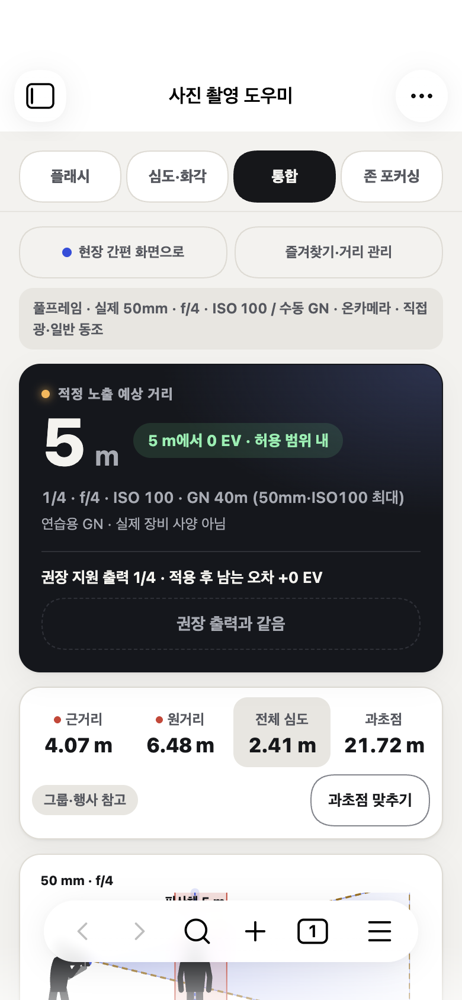
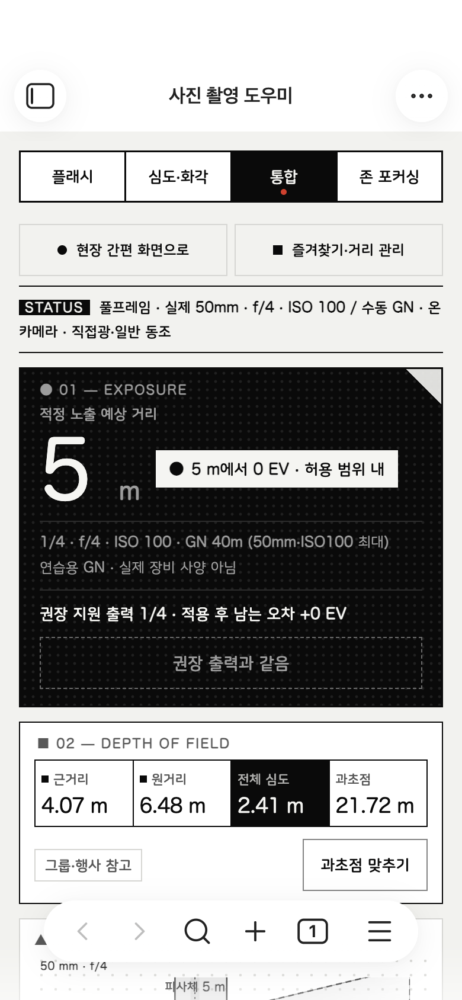
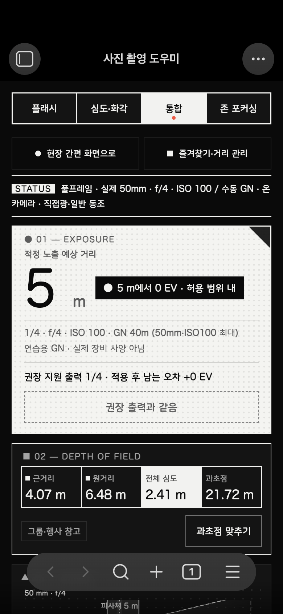
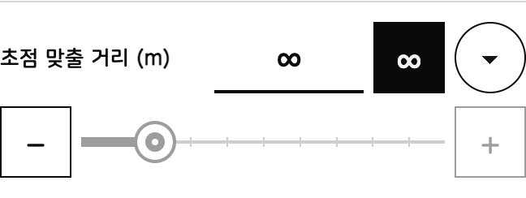
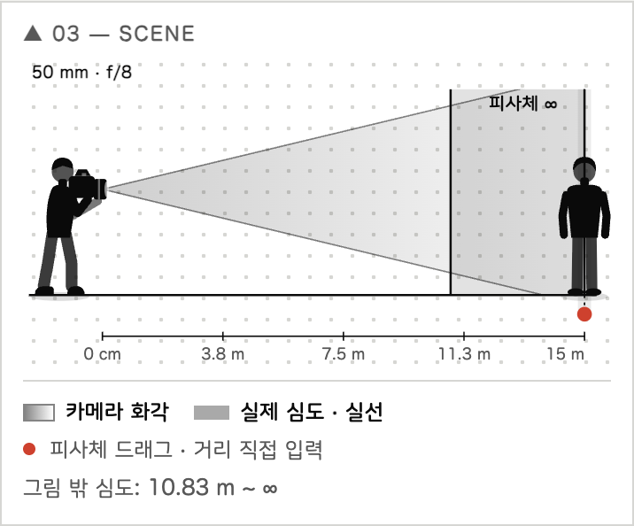

# 사진 촬영 도우미 1.5.1 · 흑백 디자인·무한대 초점·둥근 글씨

## 디자인

Teenage Engineering, Nothing, Leica의 흑백·기계적 화면을 참고해 바우하우스와 미래지향 느낌으로 다시 다듬었습니다.

- 흑백만 사용하고 빨간 신호 점 하나만 남겼습니다(초점 위치, 선택 탭, 과다·부족 노출 표시).
- 모서리는 모두 각지게, 동그라미는 슬라이더 손잡이·자주 쓰는 값·초점 점처럼 기능이 있는 곳에만 씁니다. 섹션마다 ●■▲ 기호와 번호 태그를 붙였습니다.
- 결과 카드는 라이트 모드에서 검정, 다크 모드에서 흰색으로 반전되고 점 무늬 배경을 씁니다.
- 심도 숫자는 1px 선으로 나눈 격자, 슬라이더는 눈금 자 모양입니다.
- 장면은 색 대신 무늬로 구분합니다: 회색 그라데이션=화각, 진한 띠=심도, 점선=플래시, 빗금=목표 구간.

## 초점 맞출 거리 ∞

- 초점 맞출 거리 옆 **∞** 버튼으로 켭니다. 근거리는 H−f(박막렌즈 모델에서 거리 → ∞의 극한), 원거리와 전체 심도는 ∞입니다. 과초점은 그대로입니다.
- 숫자 입력·슬라이더·±·자주 쓰는 값·장면 드래그·내 거리·과초점 맞추기·존 적용으로 거리를 바꾸면 자동으로 꺼집니다. 마지막 유한 거리는 보존됩니다.
- 온카메라 연동 중에는 플래시→피사체 거리를 정할 수 없어 플래시 결과 대신 오프카메라 안내를 표시합니다. 프레임·조사 범위도 계산하지 않습니다.
- 심도·화각과 존 포커싱 노트는 저장되며 카메라 거리를 "∞ (무한대 초점)"으로 기록합니다.

## 둥근 글씨

- 영문·숫자: iPhone의 SF Pro Rounded(`ui-rounded`). 지원하지 않는 환경은 다른 시스템 둥근 글꼴 또는 기본 글꼴로 대체됩니다.
- 한글: 나눔스퀘어라운드 Regular/Bold를 KS X 1001 한글 2,350자·자모로 서브셋해 styles.css에 내장했습니다(각 약 100KB). SIL OFL 1.1이며 예약 글꼴 이름 규정에 따라 내부 이름을 'PFM Round KR'로 바꿨습니다. 출처·라이선스는 THIRD_PARTY_NOTICES.md와 vendor/NanumSquareRound-OFL.txt에 있습니다.

## 기타

- 장면 그림 위에 마우스를 올리면 Obsidian 툴팁 코드에서 나던 오류(`isShown`)를 고쳤습니다. 화면 읽기 이름은 그대로입니다.
- 데이터 형식은 `focusInfinity`(기본 끔) 추가뿐입니다. 기존 설정·장비·즐겨찾기를 그대로 사용합니다.

## 화면

| 1.5.0 | 1.5.1 라이트 | 1.5.1 다크 |
|---|---|---|
|  |  |  |

∞ 초점:  

## 검증 범위

- strict 빌드, 자동 101개(무한대 초점 6개 추가).
- 별도 macOS Obsidian 모바일 에뮬레이션에서 모바일 QA 17개, 필드 모바일·확장·레거시(거리·준비·장면·슬라이더)·장비·존 기준점 회귀, 무한대 초점 실제 조작 11개 통과.
- Mac 화면의 영문 둥근 글씨는 Hiragino Maru Gothic으로 대체되어 보이며, iPhone에서는 SF Pro Rounded로 표시됩니다.
- 실제 iPhone·Android, 야외 가독성, 실제 키보드는 미검증입니다.
