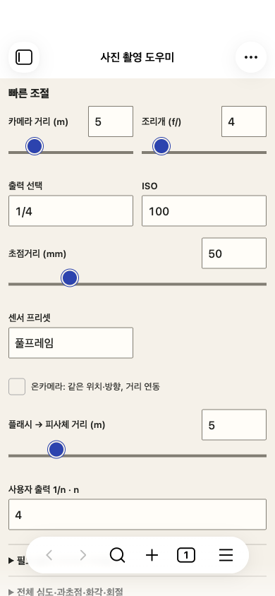
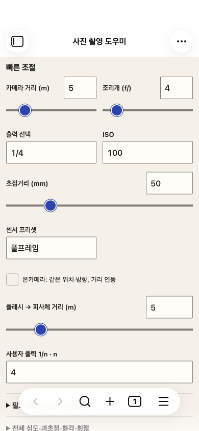

# 빠른 조절 손잡이·트랙 정렬 수정 · 2026-10-29

사용자가 지적한 문제는 빠른 조절 슬라이더의 원형 손잡이가 선 위로 떠 있는 것이었다. 이전에 입력칸 높이·전체 넘침만 검사하고 실제 트랙/손잡이 정렬을 놓쳤다.

## 재현과 원인

전용 macOS Obsidian1.14.5 모바일 에뮬레이션에서 카메라 거리·조리개·초점거리·오프카메라 플래시 거리 모두 재현했다. 트랙 중심보다 손잡이 중심이 **9px 위**에 있었다.

Obsidian 기본 thumb 스타일은 `position:relative; top:var(--slider-thumb-y)`를 사용하며 기본 변수는−9px, active 변수는−11px다. 플러그인은 자체24px 손잡이/4px 트랙과 margin-top:−10px를 지정했지만 호스트의 top을 초기화하지 않아 보정이 중복됐다. 이번 CDP 터치 측정에서 관찰한 편차는−9px였다.

## 수정

플러그인 범위의 `::-webkit-slider-thumb`에 **`top:0` 한 속성**을 추가했다. 손잡이 크기·44px 입력 영역·숫자 입력칸·계산/저장 방식·장면 구성은 변경하지 않았다. Q20III 프리셋과 앞선 두 UI 수정도 그대로 보존했다.

| 수정 전 | 수정 후 |
| --- | --- |
|  |  |

두 실제 캡처를 새로 생성하고 직접 열어 비교했다. HTML 목업·이미지 시안이 아니다.

## 검사

`tests/slider-alignment.mjs`는 일반 `getComputedStyle`의 가상 요소 값에 의존하지 않는다. CDP로 Chromium의 네이티브 range shadow DOM에서 실제 track/thumb border quad를 읽어 중심을 비교한다.

- 360×800·390×844·430×932·844×390, 라이트/다크,4개 슬라이더,최소/중간/최대,손가락을 누른 상태/놓은 상태: **192개 좌표 측정**.
- 수정 전192개 모두 중심 정렬 실패(−9px). 수정 후192개 모두 중심 차이0px. 허용 오차0.5px 기준은 동일.
- 실제 손잡이 중앙에서 CDP touchStart→12회 touchMove→touchEnd로 드래그. 최소/최대 끝점 및 중간값 도달, 숫자 입력과 동기화,44px 터치 영역 검사.
- 초기 짧은 드래그 검사에서는 조리개4→0.7의 약15px 이동으로 드래그가 시작되지 않았다. 큰 이동으로 실제 네이티브 드래그를 검증하도록 최대값에서 최소값으로 출발 조건을 명시했다. 끝점 기대값을 완화하거나 제품 이벤트를 직접 호출하지 않았다. 첫 실패 출력은 short-drag-attempt.log에 보존했다.
- 수정 전/후 판정과 원시 좌표는 [baseline/results.json](baseline/results.json), [after/results.json](after/results.json). 전용 창이 닫혀 있던 첫 시도는 경로 검사에서 중단했고 실사용 앱을 대신 조작하지 않았다. 전용 프로필에서 등록된 테스트 보관함만 다시 열어 검사를 계속했다.

최종 빌드·자동55개 통과. 관련 모바일17·스와이프6·Q20III3·앞선 UI4 =30개와 새 정렬 검사2개 모두 통과. 출력은 runs/에 보존한다. 검사 호스트는 **macOS Obsidian 모바일 에뮬레이션**이며 실제 iOS·네이티브 키보드 검증을 뜻하지 않는다.

## 후보와 복구

현재 main.js·manifest.json·styles.css 및 원본 라이선스/고지를 포함한 [최신 설치 후보](../../dist/photo-field-mobile-1.2.0-q20iii-slider-fix.zip)를 준비했다. Q20III와 앞선 UI 수정도 포함한다. ZIP 내부 파일과 현재 파일의 바이트/체크섬 비교는 packages.json과 SHA256SUMS에 기록한다. 개인 data.json·설정·노트는 포함하지 않는다.

[수정 직전 복구 ZIP](../../dist/photo-field-mobile-1.2.0-before-slider-recovery.zip)은 Q20III까지 포함한 수정 직전 파일이다. 플러그인을 끄고 main.js·manifest.json·styles.css 세 파일만 함께 되돌린 뒤 다시 켠다. data.json과 노트는 삭제/교체하지 않는다. 소스 버전1.2.0 유지, 새 도구·의존성 설치·실사용 적용·공개 배포·push 없음.
